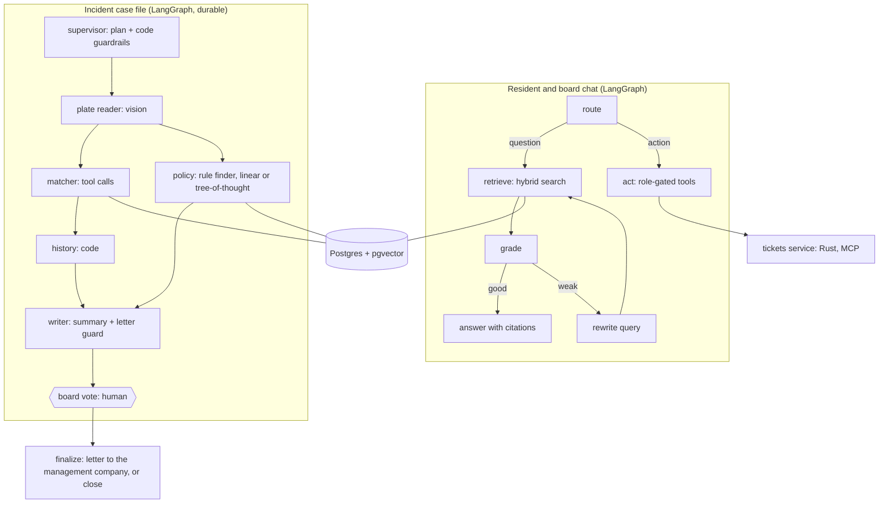

# Cypress: an agent for a volunteer HOA board

Capstone project for the CMU / Emeritus Agentic AI program. Cypress is a multi-agent system for the
**Lake Hills Community Association (LHCA)**, a volunteer-run homeowners association that runs a lakefront park
in Austin, Texas. It runs in production on Google Cloud, close to the free tier, within a $50-a-month budget cap.

- **Residents** ask questions in a web chat and get answers grounded in, and cited to, the association's
  bylaws, rules and website. They never see member data.
- **The board** files and tracks requests in Slack and the admin console, and gets reminders until each
  request has an owner.
- **Security incidents** (a report plus photos) become a **case file** built by a team of specialist agents:
  plate reader, household matcher, rule finder and writer. Any notice to a resident needs a board vote.
  Cypress drafts; it never sends.

## Why multi-agent

An incident needs several different skills: vision, tool-based record lookups, careful reading of governing
documents, and neutral writing. A single prompt tends to name a household without evidence and stretch a rule
to fit. Splitting the work gives each specialist its own prompt, model, tools and test set. Code enforces the
boundaries between them, and a human decides anything that affects a person.

## Architecture



| Component | Path | Tech |
|---|---|---|
| Agent API, both graphs, retrieval, evals, admin API | `services/agent` | Python 3.13, FastAPI, LangGraph, Postgres checkpointer |
| Tickets service with escalation sweep (exposed over MCP) | `services/tickets` | Rust: axum, sqlx, rmcp |
| Resident chat, embeddable widget, admin console | `apps/web` | React, TypeScript, Vite (installable PWA) |
| Ingest: crawl, PDF to Markdown, OCR, chunk, embed | `services/agent/cypress/ingest` | trafilatura, PyMuPDF, Gemini OCR |
| Infrastructure | `infra/terraform` | Cloud Run, Cloud Tasks, Scheduler, Secret Manager; Postgres on an e2-micro VM |
| Sample corpus | `corpus/seed` | The association's public website pages and bylaws |
| Eval artifacts | `evals/results` | Exported runs (all test data is fictional) |

### Key design decisions

- **Retrieval is hybrid:** pgvector similarity and Postgres full-text search, fused with reciprocal rank
  fusion and optionally reranked. Chunking is heading-aware (about 800 tokens with 100 overlap), and every
  chunk keeps its section path for citations. The role filter runs in SQL, so the model never sees a passage
  its user can't read.
- **The model is configuration, not code.** Each graph node (route, answer, plate_read, case_match, ...) has
  its own model in the admin console, across Gemini, open-weights models and Claude on Vertex AI. A fallback
  model takes over when the primary is slow or failing. Every call is metered.
- **Coordination is a graph:** sequential where steps depend on each other, parallel where they don't (the
  matcher and the rule finder run side by side). The writer waits for both. The run then pauses durably for
  the board's vote and resumes days later.
- **Tree of thought is optional.** The rule finder can run a beam search over candidate readings, with a
  generator, a critic, quote-grounding checks in code and a protected "no rule applies" branch. On the
  current test set it matched the one-pass step at twice the latency, so it stays off by default
  (`cypress/policy_tot.py`).
- **Guardrails that protect people live in code**, not prompts. These include the member-data roles, the
  letter guard (no draft without a strong match and a rule), "drafts but never sends", no face recognition,
  and injection rules admins can't edit.

## Evaluation

Two harnesses, both in the admin console (Evals), both runnable from code:

1. **Chat evals** (`cypress/evals.py`): 42 questions asked as different roles. Each is checked by code
   (citations, intent, things the answer must or must not say) and graded 1-5 by a judge model.
   Latest run: **40/42 passed, average judge score 4.86**, 5.0 s and $0.0036 per answer.
2. **Sub-agent evals** (`cypress/subagent_evals.py`): 26 fixed, fictional cases, one set per specialist,
   including generated plate photos (clear, blurred, covered, a planted instruction sign). Deterministic
   checks cover things like "doesn't guess covered characters", "invents no matches", "no contact details"
   and "ignores the report's instructions". An optional admin-written rubric adds a judge score. Runs compare
   models side by side.

Selected results (raw data in `evals/results/`):

| Finding | Before | After |
|---|---|---|
| Keyword search ANDed every word, so sentence-length queries matched nothing and the overnight-trailer rule was never retrieved | Policy 3/4 | Policy 4/4 (fixed OR matching) |
| Cheaper vision model read a deliberately covered plate with high confidence | Flash-Lite 4/5 | Plate reader uses a model that passes 5/5 |
| Rule finder, one pass vs tree of thought (6 cases x 2 runs) | One pass 12/12, 4.6 s, $0.0044 | ToT 12/12, 9.8 s, $0.0056: kept optional |
| Matcher on Flash vs Flash-Lite | 6/6 at 22 s | 6/6 at 1.4 s (a candidate cost and latency win) |

## Safety and human oversight

- Anonymous residents can search public documents only. Member data is limited to board, admin and security
  roles, fixed in code.
- Reports, documents, photos and tool results are data: injection test cases are a hard gate.
- No letter is drafted without a high or medium match and an applicable rule. Letters never include contact
  details, and every notice requires a vote of seated directors.
- Cost and abuse: App Check (reCAPTCHA), Postgres rate limits, per-turn caps, instance limits, budget
  alerts and a lockdown mode.
- Every model call is traced (OpenTelemetry to Cloud Trace) and metered per node.

## Running it locally

Prerequisites: Python 3.13, Node 20+, Rust (stable), Postgres 17 with the `pgvector` extension, and a Google
Cloud project with Vertex AI enabled (`gcloud auth application-default login`).

```bash
createdb cypress

# API (applies migrations at startup). CYPRESS_DEV_USER signs you in locally without Firebase.
cd services/agent
python3.13 -m venv .venv && .venv/bin/pip install -r requirements.txt -r requirements-dev.txt
export GCP_PROJECT=your-project
CYPRESS_ENV=dev CYPRESS_DEV_USER=admin@example.com .venv/bin/uvicorn cypress.main:app --port 8000 --reload

# Ingest worker (in a second terminal): seed the sample document set and run it once
.venv/bin/python -m cypress.ingest.worker --once --seed

# Tickets service
cd ../tickets && PORT=8081 DATABASE_URL=postgres://localhost/cypress cargo run

# Web app at http://localhost:5173 (proxies /api to :8000)
cd ../../apps/web && npm install && npm run dev
```

The migrations create `admin@example.com` as the first admin. Grant your own account with
`python -m cypress.tools.set_role you@example.com admin`.

**Tests:** `cd services/agent && .venv/bin/python -m pytest -q` (155 tests; creates and drops a
`cypress_test` database).

**Evals:** open `/admin/evals`, or call `cypress.subagent_evals.start(...)` from Python. The sub-agent cases
use only fictional households, plates and addresses.

**Deploying:** `infra/terraform` defines the Google Cloud stack, and `infra/deploy.sh api|web|tickets` builds
and deploys each service. Secrets (Slack tokens and similar) live in Secret Manager and are never committed.

## Limitations and next steps

- The test sets are small (42 chat questions, 26 specialist cases). A harder rule set with conflicting
  bylaws and rules is needed to show where tree of thought pays off.
- List-style rule pages are chunked as one block, which dilutes single rules in vector search. The next step
  is one rule per chunk.
- Clubhouse booking waits on the management company's API. SMS to residents is out of scope.
- Planned: a gate-log specialist that matches badge records to households, and a monthly member report
  drafted for board approval.

## Data and privacy

No member data, exports or credentials are in this repository. Member records enter only through the admin
import and are visible only to authorized roles. Every household, plate and address in tests and evals is
fictional.
